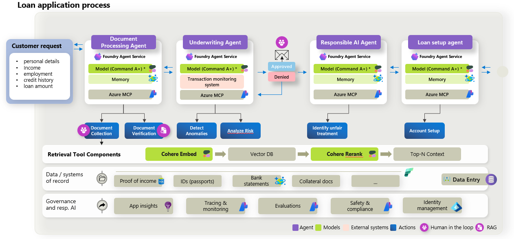
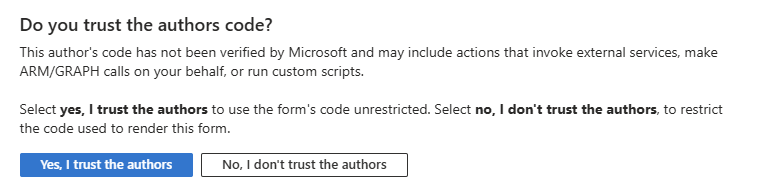

# Agentic loan and mortgage processing with Microsoft Foundry and Cohere models

## Overview

This sample demonstrates an agentic application built with Microsoft Foundry, Microsoft Foundry prompt agents, Agent Framework, Cohere models, MCP tools, and a web frontend.

The application implements a domain-specific multi-agent workflow for loan and mortgage processing. It includes infrastructure-as-code, generated sample data, backend orchestration, prompt-agent provisioning, and a deployable frontend experience.

Deploy without wizard:

[](https://portal.azure.com/#view/Microsoft_Azure_CreateUIDef/CustomDeploymentBlade/uri/https%3A%2F%2Fraw.githubusercontent.com%2FFoundry-Industry-Sandbox%2Fcohere-load-and-mortgage%2Frefs%2Fheads%2Fmain%2Finfra%2FmainTemplate.json)

Deploy with the UI wizard (requires consent):

[](https://portal.azure.com/#view/Microsoft_Azure_CreateUIDef/CustomDeploymentBlade/uri/https%3A%2F%2Fraw.githubusercontent.com%2FFoundry-Industry-Sandbox%2Fcohere-load-and-mortgage%2Frefs%2Fheads%2Fmain%2Finfra%2FmainTemplate.json/createUIDefinitionUri/https%3A%2F%2Fraw.githubusercontent.com%2FFoundry-Industry-Sandbox%2Fcohere-load-and-mortgage%2Frefs%2Fheads%2Fmain%2Finfra%2FcreateUiDefinition.json)

> The Deploy to Azure button deploys the precompiled ARM template generated from the Bicep files in `/infra`. See [`docs/deployment-parameters.md`](./docs/deployment-parameters.md) for template parameters.

## Scenario

A loan officer or underwriter reviews a synthetic mortgage application. Four Foundry prompt agents process documents, evaluate risk, review the human decision, and prepare loan setup. The workflow includes retrieval over policies and case evidence, MCP tool calls, and a human-in-the-loop approval step after underwriting.

## Architecture



## What this sample demonstrates

- Multi-agent orchestration with Agent Framework.
- Prompt-agent provisioning in Microsoft Foundry.
- Use of Cohere models through Microsoft Foundry (Command A, embed, rerank).
- Retrieval-augmented generation over domain-specific data.
- MCP-based tool access from backend agents.
- End-to-end deployment using Bicep and ARM.
- A frontend experience for running and inspecting the workflow.
- Responsible AI touchpoints such as governance policies, audit logging, and human approval.

## Repository structure

| Path | Description |
|---|---|
| `/agent-provisioning` | Scripts and definitions used to create Microsoft Foundry prompt agents. |
| `/backend` | Backend application, main Agent Framework workflow, MCP servers, and REST API used by the frontend. |
| `/data-generation` | Scripts and source assets used to generate synthetic demo data. |
| `/dataset-seed` | Generated sample dataset used by the application. |
| `/docs` | Additional documentation, diagrams, walkthroughs, and design notes. |
| `/frontend` | Frontend application used to run the workflow and inspect results. |
| `/infra` | Bicep templates, compiled ARM templates, and deployment scripts for Azure. |
| `README.md` | Main entry point for understanding, deploying, and running the sample. |

## Prerequisites

Required:
- Azure subscription.
- Access to Microsoft Foundry.
- Access to the required Cohere models in Microsoft Foundry (Command A+, embed-v4, rerank-v4).

Optional:
- Python 3 (only if regenerating demo data under `/data-generation`).
- Microsoft Fabric workspace (only when enabling Fabric integration at deploy time).

## Quick deploy

1. Click **Deploy to Azure**.
2. Select the target subscription and resource group.
3. Provide the required model, region, and application parameters. See [`docs/deployment-parameters.md`](./docs/deployment-parameters.md).
4. Wait for the deployment to complete.
5. Open the deployed frontend URL from the deployment output (`frontendUrl`).

> Deployment provisions the Azure resources required to run the sample application. It does not regenerate the synthetic dataset.

Microsoft Fabric integration is **optional**. To enable it, complete the pre-deploy identity steps in [docs/fabric-setup.md](./docs/fabric-setup.md) before deploying with `enableFabric=true`.

## Local development

### 1. Provision infrastructure

See [`infra/README.md`](./infra/README.md).

### 2. Provision Foundry prompt agents

See [`agent-provisioning/README.md`](./agent-provisioning/README.md).

### 3. Start the backend

See [`backend/README.md`](./backend/README.md).

### 4. Start the frontend

See [`frontend/README.md`](./frontend/README.md).

## Configuration

See [`docs/configuration.md`](./docs/configuration.md) for environment variables and Azure resource settings.

For local debugging, copy [`backend/src/Api.Host/.env.local.example`](./backend/src/Api.Host/.env.local.example) to `.env.local` and fill in your Foundry and Search endpoints.

## Demo walkthrough

1. Open the frontend.
2. Select or review the sample dataset.
3. Start the workflow.
4. Inspect each agent step.
5. Review retrieved context, tool calls, model outputs, and final recommendation.
6. Approve or reject the human-in-the-loop decision, when applicable.
7. Export or inspect the final result.

See [`docs/demo-script.md`](./docs/demo-script.md) for a seller-ready talk track.

## Cost and cleanup

This sample creates Azure resources that may incur costs.

Cost analysis and monthly estimates cover Search, Container Apps, Foundry models, and Log Analytics.

- Conservative monthly infrastructure floor: about USD 103.91 (mostly provisioned Search plus Container Apps idle).
- Estimated variable unit costs:
  - Ingestion: about USD 0.255 per run.
  - Search & Chat query: about USD 0.020 per run.
  - Curation/Compliance: about USD 0.015 per run.
- Medium usage projection (300 ingestions, 3,000 queries, 900 curations): about USD 253.91/month.

Primary optimization opportunities:

- Reduce frontend polling traffic (notably repeated calls to scenarios and vector-db/summary).
- Lower idle Container Apps consumption.
- Optimize long and repetitive prompts (prompt cache was not used in the baseline).

For full assumptions, formulas, and service-level breakdowns, see [Client cost analysis](./docs/Client_cost_analysis.md) and [Technical cost methodology](./docs/Technical_cost_calculation_methodology.md).

To avoid continued charges, delete the resource group after completing the demo.

```bash
az group delete --name <resource-group-name> --yes --no-wait
```

## Implementation choices and TODOs

### Prompt agents vs hosted agents

This sample uses **Microsoft Foundry prompt agents** provisioned from `agent-provisioning/`. We initially evaluated **hosted agents**, but the first Agent Framework workflow runs failed when executing agents with:

```text
Required property 'logprobs' is missing
```

The only public reference we found for this error is [microsoft/agent-framework#5854](https://github.com/microsoft/agent-framework/issues/5854). Until that issue is resolved, use prompt agents for Agent Framework orchestration in this sample.

### UI-only workflow completion

The final step of the demo workflow is shown in the **frontend only**; the outcome is **not persisted** by the backend API. Completing human approval after underwriting does **not** create or persist a loan/mortgage setup record.

### Microsoft Fabric integration

Optional Fabric support is implemented at the **MCP layer only**: agents read case supporting evidence through MCP tools (`get_case_documents`, `enrich_customer_context`), which can switch between local `dataset-seed` and Fabric OneLake via `DataSource:Mode`. Loan ingest PDFs, evidence indexing, policy indexing, and the scenario catalog stay on bundled local assets by design.

To enable Fabric, follow [docs/fabric-setup.md](./docs/fabric-setup.md).

## Known limitations

- This sample is not production-ready.
- The dataset is synthetic.
- The workflow is optimized for demonstration clarity, not throughput.
- Some deployment settings may require adjustment based on region, quota, and model availability.
- Responsible AI, security, monitoring, and compliance controls must be reviewed before production use.
- Workflow execution state is stored in memory in the API host and is lost on restart.

## Known issues

For the scenario where you want to deploy the solution using the UI wizard, note that the UI definition calls Azure REST APIs to get model capacities for the region where you want to deploy the Foundry models. This requires user consent and displays the following dialog:



## Related documentation

- [Documentation index](./docs/README.md)
- [Architecture](./docs/architecture.md)
- [Deployment parameters](./docs/deployment-parameters.md)
- [Fabric setup (optional)](./docs/fabric-setup.md)
- [Data model](./docs/data-model.md)
- [Agent governance](./docs/agent-foundry-governance.md)
- [Troubleshooting](./docs/troubleshooting.md)

## License

See [LICENSE](./LICENSE.txt) if present in the repository.

## Acknowledgments

The code in this repository was built by the engineering team at [SOUTHWORKS](https://www.southworks.com/). We gratefully acknowledge their expertise and contributions, which made this project possible.