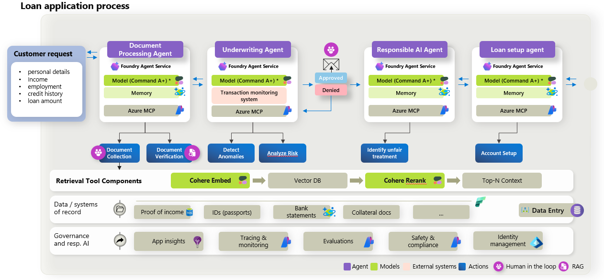

# Architecture

## High-level architecture

## Agent topology

| Stage | Foundry agent | MCP endpoint |
|---|---|---|
| 1 | `document-processing-agent` | `/document-retrieval/mcp` |
| 2 | `underwriting-agent` | `/underwriting-rules/mcp` |
| 3 | Human reviewer (API pause) | — |
| 4 | `responsible-ai-agent` | `/policy-knowledge/mcp` |
| 5 | `loan-setup-agent` | `/loan-setup/mcp` |

Each agent connects to a dedicated MCP route. Tool access is restricted per agent through governance policies. See [agent-foundry-governance.md](./agent-foundry-governance.md).

## Data flow

1. **Ingest** — Case documents are read from `dataset-seed/cases/{caseId}/ingest/`.
2. **Indexing** — Evidence is embedded (Cohere embed-v4) into Azure AI Search.
3. **Retrieval** — Agents query evidence and policies; results are reranked (Cohere rerank-v4).
4. **Structured output** — Each agent returns strict JSON (`summary`, `decision`, `evidence`, plus role-specific fields).
5. **Human gate** — Underwriting output pauses the workflow until the reviewer resumes.
6. **Setup** — Loan setup consolidates prior agent outputs.

## MCP integration

The MCP host exposes four HTTP MCP servers. Foundry agents call tools over HTTPS. Governance wraps each tool invocation before the handler runs.

## Model usage

| Model | Deployment (default) | Use |
|---|---|---|
| Cohere Command A+ | `cohere-command-a-plus` | All four prompt agents |
| Cohere embed-v4 | `cohere-embed-v4` | Evidence and policy vector indexing |
| Cohere rerank-v4-pro | `cohere-rerank-v4-pro` | Retrieval reranking |

Models are deployed through Microsoft Foundry as part of [`infra/main.bicep`](../infra/main.bicep).

## Deployment architecture

Bicep deploys Foundry, Search, Container Apps (API, MCP, frontend), Container Apps Jobs (policy seed, agent provisioning), an Azure Container Instances post-deployment runner, and observability. The runner uses a user-assigned managed identity and explicit Azure CLI managed-identity login, then starts and monitors the two jobs sequentially. Optional Fabric provisions a lakehouse and seeds case data when Fabric deployment is enabled (`enableFabric=true`).

Prebuilt container images are published by the GitHub Actions workflow [`.github/workflows/publish-container-images.yml`](../.github/workflows/publish-container-images.yml). On each run to `main` (or via `workflow_dispatch`), the workflow builds and pushes these images to Docker Hub using the `DOCKERHUB_USERNAME` and `DOCKERHUB_TOKEN` repository secrets:

| Image | Dockerfile | Default tag used by Bicep |
|---|---|---|
| `cohereloan-api` | `backend/src/Api.Host/Dockerfile` | `ghcr.io/foundry-industry-sandbox/cohereloan-api:demo` |
| `cohereloan-mcp` | `backend/src/LoanWorkflow.Mcp/Dockerfile` | `ghcr.io/foundry-industry-sandbox/cohereloan-mcp:demo` |
| `cohereloan-provisioning` | `agent-provisioning/Dockerfile` | `ghcr.io/foundry-industry-sandbox/cohereloan-provisioning:demo` |
| `cohereloan-web` | `frontend/src/WebApp/Dockerfile` | `ghcr.io/foundry-industry-sandbox/cohereloan-web:demo` |

Each image is also tagged with the commit SHA. Override image URIs with the `*ContainerImage` template parameters if you publish to another registry.

Template parameters are documented in [deployment-parameters.md](./deployment-parameters.md).

## Security boundaries

- Managed identities connect API and MCP workloads to Foundry and Search.
- The post-deployment runner uses Microsoft Entra ID authentication without storage account keys.
- MCP tool governance enforces per-agent allow/deny rules.
- The sample uses public network access for demo simplicity.
- Synthetic data only; no real customer PII in the seed package.
